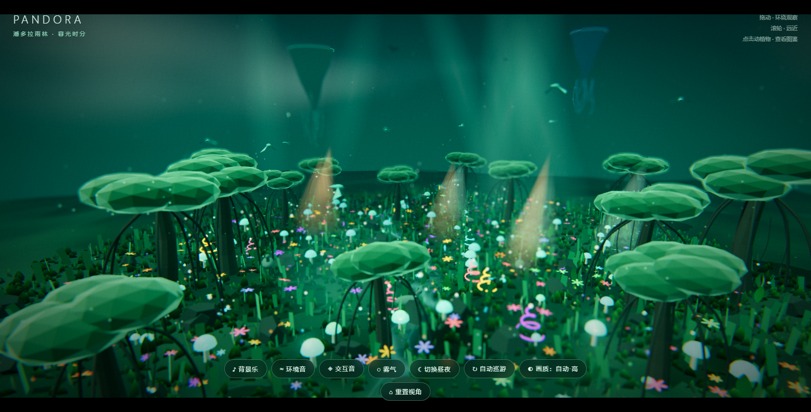

# 🌿 Pandora · 潘多拉雨林

一个用 **Three.js** 打造的电影感交互式 3D 场景——致敬《阿凡达》中潘多拉星球的暮光雨林。单个 HTML 文件，无需构建，打开即玩。

**🔗 在线体验：** https://smilegithub01.github.io/pandora-forest/


<sub>▲ 实际运行画面：暮光时分的雨林，荧光植物与丁达尔光柱（Three.js 实时渲染）</sub>

## ✨ 特色

**电影质感**
- 景深（焦点自动追随观察目标）、辉光、青橙调色、镜头色散、动态胶片颗粒、暗角
- 进入时电影式推镜 + 2.39:1 宽银幕遮幅
- 手持摄影机微晃与镜头“呼吸”

**生态世界**
- 起伏地形、巨榕与气生根、7000 株随风摆动的草、蕨类、灌木、荧光蘑菇、缤纷花海
- 六足兽、翔鸟、流光蝶、远空伊卡兰、萤火虫、圣树种子
- 月光溪流、悬浮山与发光垂藤、丁达尔光柱、地面薄雾

**交互**
- 点击动植物查看图鉴，螺旋花被触碰会卷曲
- 萤火虫会躲避鼠标
- 全程序化生成的背景乐 / 环境音 / 空间化交互音（无音频文件）
- 昼夜切换、雾气开关、自动巡游、双击全屏

**性能**
- 三档画质（低 / 中 / 高），自动模式根据帧率实时升降档

## 🎮 操作

| 操作 | 功能 |
|---|---|
| 拖动 | 环绕观察 |
| 滚轮 | 拉近 / 拉远 |
| 点击 | 查看动植物图鉴 |
| 双击 | 全屏 |
| 底部按钮 | 声音、雾气、昼夜、巡游、画质、重置视角 |

## 🚀 本地运行

由于使用了 ES Module，建议通过本地服务器打开：

```bash
npx serve .
# 或
python -m http.server 8000
```

然后访问 `http://localhost:8000`。需要联网（Three.js 从 jsDelivr CDN 加载）。

## 🛠 技术栈

- [Three.js](https://threejs.org/) r187 · WebGL
- EffectComposer 后期：BokehPass / UnrealBloomPass / 自定义调色 Shader
- Web Audio API 程序化声音

## 📄 License

MIT
